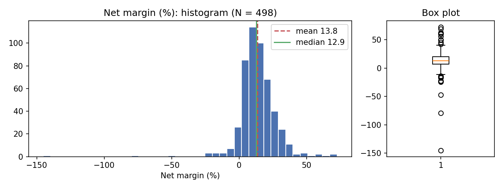
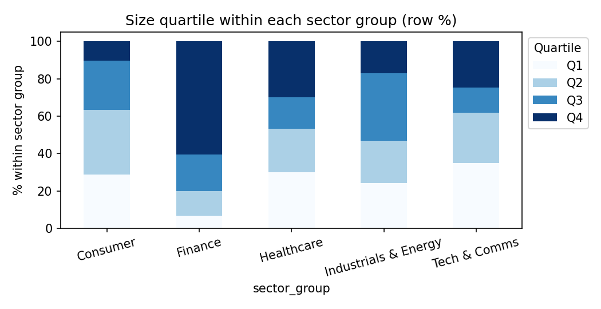
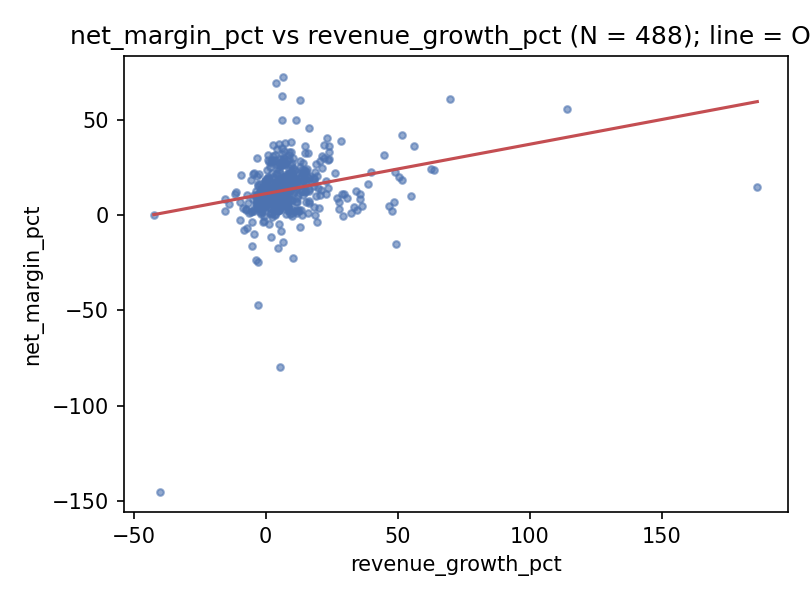
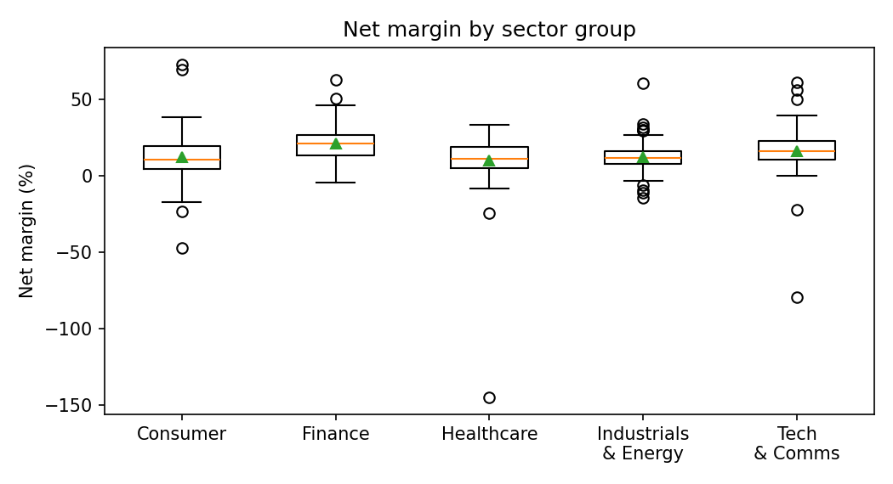

# Rapport de référence — Qu'est-ce qui explique la rentabilité des entreprises du S&P 500 ?

**Statut : version de référence calculée par programme (`python -m src.analysis`), non encore reproduite dans Jamovi.** Les chiffres sont des résultats « référence », pas des sorties Jamovi. Ils seront rapprochés de celles de David (étape 2), puis le texte sera finalisé dans le Google Doc (étape 3). Données : `data/processed/sp500_2025_JAMOVI.csv` (500 entreprises ; empreinte SHA-256 dans `outputs/analyses_reference/results.json`). Tableaux : `outputs/analyses_reference/`. Graphiques : `outputs/figures_reference/`. Date : 13 novembre 2026.

Équipe : David Wanono, Olyvan Perrin, Guillaume Da Cruz. (Évaluations des membres : à ajouter par le groupe sur la couverture du PDF.)

---

## 1. Résumé exécutif (une page)

**Question.** Parmi les entreprises du S&P 500 au 31 décembre 2025, qu'est-ce qui est associé à une marge nette plus élevée : la taille, l'endettement, la croissance du chiffre d'affaires ou le secteur ? Données : comptes du dernier exercice annuel clos en 2025 de 498 entreprises (sur 500), déposés auprès de la SEC. Il s'agit d'associations observées à un instant donné, pas d'effets causaux.

**Ce que disent les données.**
- La marge nette médiane est de 12,9 % ; elle est très dispersée (de −145 % à +73 %) : la médiane décrit mieux l'entreprise typique que la moyenne (13,8 %).
- Le **secteur financier** se distingue : marge moyenne de 20,9 % contre 12,5 % hors finance, soit +8,4 points (intervalle de confiance à 95 % : 5,5 à 11,4 ; d de Cohen = 0,59, effet moyen). Les autres groupes de secteurs ne se distinguent pas nettement entre eux.
- À secteur, taille et endettement donnés, **un point de croissance du chiffre d'affaires est associé à 0,25 point de marge en plus** (IC 95 % : 0,16 à 0,33 ; p < 0,001), résultat de même signe et significatif avec les erreurs classiques dans les trois variantes testées (0,14 à 0,25) ; avec les erreurs robustes la significativité est limite (p de 0,04 à 0,08 dans trois cas sur quatre).
- **Taille et endettement n'expliquent pas la marge nette** (p = 0,98 et 0,45 dans le modèle complet). En revanche, la taille est associée à un **ROA plus faible** (−1,97 point par unité de log de l'actif, p < 0,001).
- Le modèle complet n'explique que **11 %** de la variation des marges (R² ajusté 10 %) : l'essentiel dépend d'autres facteurs non mesurés ici.

**Trois recommandations.**
1. **Fixer les repères de marge par secteur, pas pour tout le S&P 500** : une marge de 12 % est moyenne hors finance mais faible en finance (médiane 21,0 % contre 12,1 %). Utiliser les groupes de secteurs comme référence dans toute comparaison de rentabilité.
2. **Suivre la croissance du chiffre d'affaires comme levier associé à la rentabilité** : +10 points de croissance vont de pair avec environ +2,5 points de marge (de +1,4 à +2,5 selon la variante), toutes choses égales par ailleurs. Association à confirmer (inférence robuste limite) sur des données dans le temps avant de promettre un effet.
3. **Ne pas présélectionner ni prévoir la marge d'une entreprise d'après sa taille ou son endettement** (aucune association significative), et choisir l'indicateur selon l'objectif : marge pour la performance d'exploitation, ROA pour l'efficacité du capital, ce dernier diminuant avec la taille.

---

## 2. Données : source, provenance, nettoyage

Sources officielles et gratuites : API SEC Company Facts et rapports annuels (10-K), composition du S&P 500 reconstituée au 31 décembre 2025 (annonce S&P et table officielle des tickers). Chaque valeur renvoie à son dépôt, sa période et son empreinte de fichier (`FICHE_PROVENANCE.md`, `financial_evidence.json`). Une ligne = une entreprise (CIK) ; 503 titres regroupés en 500 entreprises.

Nettoyage (détail et preuves dans `JOURNAL_NETTOYAGE.md`) : exercice retenu = dernier exercice annuel clos en 2025 (ou 52/53 semaines clos début janvier 2026) ; résultat net attribuable à la société mère ; trois revenus corrigés (Camden, Huntington, M&T) et revenus bancaires reconstitués par convention ; deux entreprises sans comptes 2025 (Dayforce, Paramount) laissées vides. Valeurs extrêmes authentiques conservées (Moderna −145 %, 32 capitaux propres négatifs). N valides : 498 pour la plupart des variables, 488 pour la croissance du chiffre d'affaires.

Variables : marge nette (%), ROA (%), actif (milliards USD, logarithme `ln_assets`), taux d'endettement (%) = 100 × (actif − capitaux propres) / actif, croissance du chiffre d'affaires (%) par rapport à l'exercice précédent du même rapport, rotation de l'actif, quartiles de taille Q1–Q4, cinq groupes de secteurs.

---

## 3. Profil des variables (séance 1)

Tableau : `s1_descriptives_continuous.csv`, `s1_frequency_*.csv`. Cinq profils.

| Variable | N | Moyenne | Médiane | Mode | Écart-type | Min – Max |
|---|---:|---:|---:|---:|---:|---|
| Marge nette (%) | 498 | 13,75 | 12,90 | 11 (arrondi) | 14,72 | −145,16 – 72,71 |
| Taux d'endettement (%) | 498 | 66,73 | 64,21 | 74 (arrondi) | 28,01 | 8,96 – 327,28 |
| Croissance du CA (%) | 488 | 8,64 | 6,37 | 4 (arrondi) | 15,12 | −42,35 – 186,28 |

**Secteur (nominal, N = 500)** : Industrials & Energy 159 (31,8 %) ; Consumer 115 (23,0 %) ; Tech & Comms 90 (18,0 %) ; Finance 76 (15,2 %) ; Healthcare 60 (12,0 %). Le mode est Industrials & Energy. **Taille (ordinale, N = 498)** : Q1 125, Q2 124, Q3 124, Q4 125, par construction (coupures de l'actif à 13,4 / 31,1 / 73,5 milliards USD).

**Normalité de la marge nette (trois preuves).** (1) Les trois mesures de centre divergent peu mais la queue est lourde : moyenne 13,75, médiane 12,90. (2) Asymétrie −2,67 et aplatissement (excès) 31,3 : très hors de l'intervalle ±1. (3) L'histogramme a un pic net et une longue queue gauche (pertes). Shapiro-Wilk : W = 0,791, p < 0,001 ; ici H0 = « normale » donc on la rejette. **La marge n'est pas normale** ; la médiane et l'étendue interquartile (6,9 à 20,3) la résument mieux. L'endettement (asymétrie 2,77) et la croissance (4,76) sont aussi très asymétriques ; l'actif est approximativement symétrique en logarithme (asymétrie 0,56).

**Ce qu'un gestionnaire retient (deux phrases).** La marge de l'entreprise typique est d'environ 13 %, avec un quart des entreprises au-dessous de 7 % et un quart au-dessus de 20 % : une moyenne seule masque cette dispersion, d'où l'usage de la médiane. Quelques cas extrêmes (pertes de Moderna, forte croissance d'Expand Energy par acquisition) tirent les moyennes et doivent être traités à part.

---

## 4. Relations entre variables (séance 2)

### 4.1 Khi-deux : secteur × taille

1. **IDENTIFY.** Secteur (nominal) et quartile de taille (ordinal) sont qualitatifs : khi-deux d'indépendance, V de Cramér pour la force. Conditions : observations indépendantes ; effectifs attendus tous ≥ 5 (minimum 14,9 ; aucune cellule < 5) ✓.
2. **HYPOTHESISE.** H0 : la répartition par taille est la même dans tous les groupes de secteurs. H1 : elle dépend du secteur.
3. **DECIDE.** χ²(12, N = 498) = 91,76, p < 0,001 : on rejette H0. V de Cramér = 0,25 : association faible à modérée. Pourcentages en ligne (`s2_chi2_row_pct.csv`) : 60,5 % des entreprises financières sont dans le quartile des plus grandes, contre 10,4 % en Consumer, 17,1 % en Industrials & Energy et 24,7 % en Tech & Comms.
   *Vérification de cohérence :* V = √(91,76 / (498 × 3)) = 0,248 ✓ ; df = (5 − 1)(4 − 1) = 12 ✓.
4. **RECOMMEND.** Les banques et assureurs dominent le haut de la distribution des actifs (leurs bilans sont structurellement grands) : utiliser la taille mesurée par l'actif pour comparer des entreprises *au sein* d'un secteur, pas entre secteurs.

### 4.2 Corrélations (Pearson et Spearman)

`s2_correlations_pairs.csv`, matrices `s2_correlation_matrix_*.csv`. Six variables continues, N de 488 à 498 par paire.

1. **IDENTIFY.** Variables quantitatives ; asymétrie forte et valeurs extrêmes : Pearson et Spearman rapportés ensemble ; si désaccord, Spearman prime. Nuages de points examinés (`s2_scatter_*`).
2. **HYPOTHESISE.** H0 : pas de relation linéaire (resp. monotone) entre les deux variables.
3. **DECIDE (paires utiles pour la marge).**

| Paire | N | Pearson r (p) | Spearman ρ (p) | Lecture |
|---|---:|---|---|---|
| Marge – croissance du CA | 488 | 0,27 (< 0,001) | 0,30 (< 0,001) | faible positive, concordante |
| Marge – rotation de l'actif | 498 | −0,22 (< 0,001) | −0,38 (< 0,001) | négative ; ρ plus fort : on retient ρ |
| Marge – taille (ln actif) | 498 | 0,09 (0,059) | 0,06 (0,204) | non significative |
| Marge – endettement | 498 | 0,04 (0,332) | −0,06 (0,190) | non significative |
| ROA – taille (ln actif) | 498 | −0,30 (< 0,001) | −0,38 (< 0,001) | négative, faible à modérée |

r² marge–croissance = 0,07 : 7 % de la variance partagée. Marge et ROA sont corrélées (r = 0,58) mais ne se confondent pas.

4. **RECOMMEND.** La croissance est la seule variable de notre jeu qui bouge avec la marge sur toute la population ; la taille ne bouge pas avec la marge mais bouge avec le ROA (plus l'entreprise est grande, plus son rendement de l'actif est faible, ρ = −0,38).

### 4.3 Test t : marge des entreprises financières contre les autres

1. **IDENTIFY.** Résultat quantitatif (marge) et deux groupes indépendants (Finance, N = 76 ; Non-finance, N = 422) : test t pour échantillons indépendants. Levene (H0 = variances égales) : F = 0,12, p = 0,73 → variances comparables, Student convient ; Welch et Mann-Whitney rapportés en confirmation (marge non normale, groupes de plus de 30).
2. **HYPOTHESISE.** H0 : marge moyenne égale dans les deux groupes. H1 : elle diffère.
3. **DECIDE.** Finance 20,90 % (écart-type 11,24) contre 12,46 % (14,92). Student t(496) = 4,70, p < 0,001 ; Welch t(127,9) = 5,70, p < 0,001 ; Mann-Whitney U = 22 740, p < 0,001. Écart = 8,44 points, IC 95 % (Welch) [5,51 ; 11,37]. d de Cohen = 0,59 : effet moyen.
4. **RECOMMEND.** Ne pas comparer la marge d'une banque ou d'un assureur à celle d'un industriel avec une même norme ; adopter un repère de 21 % (médiane) pour la finance et de 12 % pour le reste. Limite : le revenu des banques est reconstitué par convention (intérêts nets plus revenus hors intérêts), ce qui pèse sur la comparaison.

---

## 5. Différences entre groupes de secteurs (séance 3)

`s3_group_descriptives.csv`, `s3_anova_table.csv`, `s3_posthoc_*.csv`.

1. **IDENTIFY.** Résultat quantitatif (marge) ; facteur nominal à 5 groupes indépendants de 60 à 158 entreprises : ANOVA à un facteur. Normalité : Shapiro significatif dans tous les groupes (valeurs extrêmes) mais effectifs ≥ 60, ANOVA robuste ; Levene significatif (F(4, 493) = 3,61, p = 0,007 ; version médiane p = 0,009) → variances inégales → **ANOVA de Welch + Games-Howell**, avec Fisher et Kruskal-Wallis en confirmation.
2. **HYPOTHESISE.** H0 : marge moyenne identique dans les cinq groupes. H1 : au moins un groupe diffère (pas « tous différents »).
3. **DECIDE.**
   - Moyennes : Finance 20,9 ; Tech & Comms 15,9 ; Industrials & Energy 12,1 ; Consumer 11,9 ; Healthcare 9,5.
   - Welch F(4 ; 189,1) = 10,41, p < 0,001 ; Fisher F(4, 493) = 7,53, p < 0,001 ; Kruskal-Wallis χ²(4) = 46,2, p < 0,001. Les trois concordent.
   - Taille d'effet : η² = 0,058 (effet moyen) ; ε² = 0,093.
   - **Games-Howell** : Finance supérieure à Consumer (+8,98 ; p < 0,001), Industrials & Energy (+8,84 ; p < 0,001) et Healthcare (+11,39 ; p = 0,007) ; Finance contre Tech & Comms non significatif (+5,04 ; p = 0,137) ; autres paires non significatives. **DSCF** (non paramétrique) ajoute Tech & Comms au-dessus de Consumer (p = 0,022) et d'Industrials & Energy (p = 0,014).
   - *Vérification :* F = MS inter / MS intra = 1 549,5 / 205,9 = 7,53 ✓ ; df = 4 et 493 = N − 1 − 4 ✓.
4. **RECOMMEND.** Un groupe se détache nettement (la finance) ; ne pas définir d'objectif de marge distinct entre Consumer, Industrials & Energy et Healthcare : leurs écarts ne sont pas établis. Le secteur n'explique que 6 % des différences de marge (η²) : 94 % tiennent à autre chose.

---

## 6. Facteurs associés à la marge (séance 4)

`s4_*_coefficients.csv`, diagnostics `s4_*_diagnostics.png`.

**6.1 Régression simple : marge ~ taille.** N = 498. Marge = −9,49 + 0,958 × ln(actif) ; B = 0,958 (ES 0,506 ; t = 1,90 ; p = 0,059 ; IC 95 % [−0,04 ; 1,95]) ; F(1, 496) = 3,59, p = 0,059 ; R² = 0,007. La taille seule n'est pas significativement associée à la marge ; elle en explique moins de 1 %. *Vérification :* t = B / ES = 0,958 / 0,506 = 1,90 ✓. Le résidu n'est pas normal (extrêmes) ; DW = 1,94.

**6.2 Régression multiple.** Marge ~ ln(actif) + endettement + croissance du CA + secteur (référence : Industrials & Energy, le plus grand groupe). N = 488 (observations complètes).

1. **IDENTIFY.** Résultat quantitatif, plusieurs prédicteurs : régression linéaire multiple. Conditions : VIF maximal 1,41 (< 5) ✓ ; Durbin-Watson 1,96 ✓ ; homoscédasticité : Breusch-Pagan LM = 10,86, p = 0,145 ✓ ; **normalité des résidus non satisfaite** (Shapiro-Wilk W = 0,80, p < 0,001) à cause de valeurs extrêmes : on contrôle par des erreurs standard robustes (HC3) et des variantes.
2. **HYPOTHESISE.** Globalement H0 : aucun prédicteur n'explique la marge. Pour chaque prédicteur : H0 : pas d'effet, les autres étant contrôlés.
3. **DECIDE.** Modèle significatif, F(7, 480) = 8,80, p < 0,001 ; R² = 0,114, R² ajusté = 0,101. Coefficients :

| Prédicteur | B | Erreur std | p | β | p robuste (HC3) |
|---|---:|---:|---:|---:|---:|
| Croissance du CA (points) | 0,248 | 0,043 | < 0,001 | 0,25 | 0,046 |
| Finance (vs Industrials & Energy) | 7,84 | 2,14 | < 0,001 | 0,53 | < 0,001 |
| Tech & Comms | 2,40 | 1,88 | 0,202 | 0,16 | 0,239 |
| Healthcare | −2,21 | 2,13 | 0,300 | −0,15 | 0,440 |
| Consumer | 0,24 | 1,75 | 0,891 | 0,02 | 0,883 |
| ln(actif) | 0,01 | 0,53 | 0,982 | 0,00 | 0,982 |
| Endettement (points) | 0,018 | 0,023 | 0,447 | 0,03 | 0,577 |

   Lecture : à secteur, taille et endettement donnés, +1 point de croissance du CA est associé à +0,25 point de marge (IC 95 % [0,16 ; 0,33]) ; une entreprise financière a une marge supérieure de 7,8 points à une entreprise comparable d'Industrials & Energy. Taille et endettement n'ont pas d'association significative. L'ordonnée à l'origine n'a pas d'interprétation. Ajouter le secteur améliore le modèle (R² de 0,079 à 0,114 ; F de variation = 4,71, p = 0,001). Un exemple dans la plage observée : une entreprise financière de taille, d'endettement et de croissance médians a une marge prédite de 19,4 %.
   *Valeurs influentes :* Expand Energy (croissance de +186 % : revenus de 12,1 contre 4,2 milliards USD, avec l'acquisition de Southwestern au 1er octobre 2024 mentionnée dans le rapport annuel, donc une année 2024 partielle ; distance de Cook 0,66) et Moderna (marge −145 %, 0,59).

4. **RECOMMEND.** Suivre la croissance comme levier associé à la marge, avec prudence : le coefficient provient de comparaisons entre entreprises, pas d'une expérience, et le modèle n'explique qu'environ 10 % de la variation des marges.

**6.3 Sensibilités** (`s4_sens_*`) : la conclusion tient en signe et en ordre de grandeur ; sa significativité est solide avec les erreurs classiques, limite avec les erreurs robustes.

| Variante | N | R² | B croissance (p) | B Finance (p) | Taille (p) | Endettement (p) |
|---|---:|---:|---|---|---|---|
| Modèle complet | 488 | 0,114 | 0,248 (< 0,001) | 7,84 (< 0,001) | 0,01 (0,98) | 0,018 (0,45) |
| Sans observations influentes (4/n) | 468 | 0,142 | 0,193 (< 0,001) | 6,85 (< 0,001) | 0,38 (0,29) | −0,035 (0,039) |
| Sans le secteur financier | 418 | 0,083 | 0,250 (< 0,001) | – | −0,16 (0,80) | 0,011 (0,65) |
| Marges tronquées (1 %–99 %) | 478 | 0,123 | 0,142 (< 0,001) | 7,85 (< 0,001) | −0,07 (0,85) | 0,009 (0,58) |

Avec les erreurs robustes (HC3), le p de la croissance est de 0,046 (modèle complet), 0,077 (sans finance), 0,039 (marges tronquées) et < 0,001 (sans observations influentes) : on parle d'association **probable mais à confirmer**. Autre variation : l'endettement devient faiblement négatif sans les observations influentes (p = 0,039) : non robuste, à ne pas interpréter. Avec **le ROA comme résultat** (N = 488, R² = 0,190) : la taille est négativement associée (B = −1,97 par unité de ln(actif), β = −0,29, p < 0,001), l'endettement et la croissance positivement, et la finance n'a pas de prime ; l'hétéroscédasticité est forte (Breusch-Pagan p < 0,001), les p robustes sont donc à privilégier (croissance : p HC3 = 0,11).

---

## 7. Limites : ce que les données ne peuvent pas dire

- **Pas de causalité.** Coupe transversale : une corrélation entre croissance et marge peut venir de causes communes ou d'une causalité inverse.
- **Périodes comptables différentes** : 134 entreprises ne clôturent pas en décembre (dates exactes conservées) ; les exercices clos début 2025 couvrent surtout 2024 (par exemple Nvidia).
- **Définitions** : résultat net attribuable à la société mère ; revenu des banques et assureurs reconstitué par convention ; endettement = (actif − capitaux propres) / actif, qui inclut les minoritaires dans le passif ; la croissance est faussée par les acquisitions et reste manquante pour 12 entreprises.
- **Valeurs extrêmes** conservées parce qu'authentiques (Moderna, Expand Energy, Verisign) ; résidus non normaux ; conclusions confirmées par erreurs robustes et variantes.
- **Regroupement des secteurs** en cinq groupes : l'immobilier est rangé avec Consumer par convention ; une analyse avec les 11 secteurs d'origine est possible en complément.
- **Population** : entreprises cotées américaines présentes dans l'indice au 31 décembre 2025 ; deux entreprises sans comptes 2025 (Dayforce, Paramount) ; contrôle des retraits de 2025 encore partiel (U03).
- **Faible pouvoir explicatif** : le modèle explique environ 10 % des marges ; la rentabilité dépend surtout de facteurs absents du jeu (modèle économique, concurrence, cycle).
- **Gouvernance** : étudiée puis abandonnée le 12 novembre 2026 (DEC25) ; travail archivé, non utilisé ici.

## 8. Sources

SEC, Company Facts et rapports annuels 10-K : https://www.sec.gov/search-filings/edgar-application-programming-interfaces ; table officielle des tickers : https://www.sec.gov/files/company_tickers.json ; S&P Dow Jones Indices, annonce du 5 décembre 2025 (rééquilibrage) et révision Wikipédia 1329075976 archivée. Détail par valeur : `data/reference/financial_evidence.json`, `derived_evidence.csv`, `revenue_growth_evidence.csv`. Outils : Python 3.9, pandas 2.3.3, SciPy 1.13.1, statsmodels 0.14.6, matplotlib 3.9.4.
